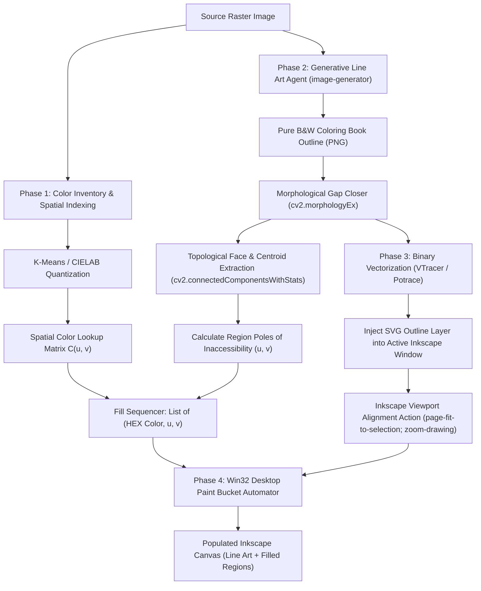

# Design Specification: Coloring Book Outline & Live Desktop Paint Bucket Pipeline

- **Date**: 2026-10-13
- **Author**: Antigravity & User Pair Programming
- **Status**: Approved Design Spec
- **Target Repository**: `Mr-Molina/inkmcp`
- **Branch**: `windows-mcp`

---

## 1. Overview & Business Intent

Current raster-to-vector workflows in `inkmcp` use planar or VTracer polygon tracing. While effective for flat vector graphics, complex raster illustrations and photographs often suffer from fragmented shading, color slivers, and excessive node counts.

This specification defines a stylized 4-phase vectorization pipeline that decouples **line art geometry** from **regional color fill**, mimicking cel animation and traditional comic production:
1. **Phase 1: Color Inventory & Spatial Indexing** — Quantizes the source raster into dominant palette clusters and builds a normalized $(u, v)$ spatial color lookup matrix.
2. **Phase 2: Generative Line Art Agent** — Converts the raster into a clean, closed black-and-white coloring book outline via the `image-generator` subagent.
3. **Phase 3: Outline Vectorization & Canvas Alignment** — Traces the binary line art into SVG paths, injects it onto an Inkscape canvas layer, and locks the viewport zoom.
4. **Phase 4: Live Desktop Paint Bucket Automation** — Extracts interior centroids (poles of inaccessibility) for all bounded regions, activates Inkscape's native Paint Bucket tool (`U` / `Shift+F7`) via Win32 desktop automation, and simulates canvas clicks to fill each bounded region with its assigned palette color.

---

## 2. Architecture & Data Flow



---

## 3. Detailed Component Specifications

### 3.1. Phase 1: Color Inventory & Spatial Indexing (`inkmcp.vectorizer.color_inventory`)

- **Class**: `ColorInventory`
- **Responsibilities**:
  - Load the source raster image via PIL / OpenCV.
  - Convert to CIELAB color space and apply K-Means clustering (default $K=8$, clamped $2 \le K \le 32$).
  - Extract dominant RGB / HEX colors and compute cluster centroids.
  - Build downscaled lookup array `color_map[v_idx, u_idx]` allowing $O(1)$ spatial queries:
    $$\text{get\_color\_at}(u, v) \to \text{"#RRGGBB"}$$
    where $u, v \in [0.0, 1.0]$ are normalized relative coordinates.

### 3.2. Phase 2: Generative Coloring Book Outline Agent Protocol (`inkmcp.vectorizer.outline_generator`)

- **Class**: `OutlineGenerator`
- **Subagent / Model Delegation**:
  - Dispatches an asynchronous request to the `image-generator` subagent (or Gemini image edit/generation API).
  - **Prompt Template**:
    > `"Convert this image into a clean, pure black-and-white coloring book style outline. Thick, closed black outlines on a pure white background (#FFFFFF). Zero shading, zero textures, zero cross-hatching, zero grayscale gradients. High contrast crisp line art."`
  - Saves the generated outline PNG to a temporary or designated working path.
- **Morphological Pre-processing**:
  - Thresholds to pure binary (0 / 255).
  - Applies morphological closing (`cv2.morphologyEx` with a small $3 \times 3$ elliptical kernel) to heal 1–2px micro-gaps in the generated outlines, preventing color leaks.

### 3.3. Phase 3: Outline Vectorization & Canvas Alignment (`inkmcp.inkmcpops.vectorize_operations`)

- **Vectorization**:
  - Passes the cleaned binary outline raster through `VTracerCore` (or `potrace`) configured with `colormode="binary"` and `hierarchical="stacked"`.
  - Creates a dedicated SVG layer:
    `<g id="layer-line-art" inkscape:label="Line Art" inkscape:groupmode="layer">`.
- **Canvas Injection & Viewport Normalization**:
  - Injects the layer into the active Inkscape document via `WindowsCliBackend.execute_operation()`.
  - Executes Inkscape CLI action to normalize viewport and establish a fixed coordinate baseline:
    ```powershell
    inkscape.com -q --actions="select-all;page-fit-to-selection;zoom-drawing;select-clear"
    ```

### 3.4. Phase 4: Live Desktop Win32 Paint Bucket Automator (`inkmcp.backends.desktop_automator`)

- **Class**: `InkscapeDesktopAutomator`
- **Subsystem Mechanics**:
  1. **Window Resolution**:
     - Enumerates top-level windows via `win32gui.EnumWindows`.
     - Identifies window with title matching `*Inkscape*` and process `inkscape.exe`.
     - Restores and forces foreground focus: `win32gui.ShowWindow(hwnd, win32con.SW_RESTORE)`, `win32gui.SetForegroundWindow(hwnd)`.
  2. **Tool Activation**:
     - Injects keystroke `'U'` (virtual key code `0x55`) or `Shift + F7` using Win32 `keybd_event` or `SendInput`.
     - Sleeps 100ms for Inkscape tool switch to complete.
  3. **Canvas Bounds & Coordinate Mapping**:
     - Retrieves the canvas client rectangle `(left, top, right, bottom)` from the canvas window.
     - Translates normalized $(u, v)$ coordinate to client space:
       $$X_{client} = X_{canvas\_left} + u \times \text{Width}_{canvas}$$
       $$Y_{client} = Y_{canvas\_top} + v \times \text{Height}_{canvas}$$
     - Translates to absolute desktop screen coordinates via `win32gui.ClientToScreen`.
  4. **Active Color Injection & Fail-safe**:
     - *Pre-click*: Sets active tool color via Inkscape style preference/clipboard.
     - *Post-click (Fail-safe)*: Since Inkscape automatically selects the newly created `<path>` after a bucket fill, executes a zero-latency `selection-set-style:fill:#RRGGBB` action if exact color enforcement is required.
  5. **Click Execution**:
     - Moves cursor: `win32api.SetCursorPos((ScreenX, ScreenY))`.
     - Dispatches click: `mouse_event(MOUSEEVENTF_LEFTDOWN | MOUSEEVENTF_LEFTUP)`.
     - Configurable delay (default: 80ms) between clicks to allow Inkscape's internal Potrace engine to compute the path.
  6. **Fail-Safe Abort**:
     - Periodically checks `win32api.GetAsyncKeyState(win32con.VK_ESCAPE)`. If pressed, immediately terminates the automation loop and logs an abort notice.

---

## 4. MCP Operation Interface

The operation will be accessible via MCP as part of `inkscape_operation` and the CLI:

```json
{
  "operation": "vectorize-coloring-book",
  "image_path": "S:/path/to/source.png",
  "num_colors": 8,
  "min_region_area": 25,
  "click_delay_ms": 80,
  "inject_to_inkscape": true
}
```

---

## 5. Error Handling & Edge Cases

1. **Inkscape Not Running / No Document**:
   - `is_available()` returns `False` if no active Inkscape window is found; returns a clear structured error response without attempting input simulation.
2. **Broken Outlines / Gaps**:
   - Morphological closing filters out small breaks.
   - Inkscape's Paint Bucket preferences configured with `close_gaps: medium`.
3. **Speckle Filtration**:
   - Bounded regions with area $< 25\text{px}^2$ are ignored by the sequencer to avoid clicking noise dots.
4. **Window Focus Loss**:
   - If `GetForegroundWindow() != inkscape_hwnd`, the sequencer re-asserts foreground window focus before dispatching the next click.

---

## 6. Testing Strategy

1. **Unit Tests (CI & Headless Safe)**:
   - `test_color_inventory.py`: Tests color quantization and $(u, v)$ coordinate color retrieval on synthetic image fixtures.
   - `test_region_topology.py`: Tests connected components and pole-of-inaccessibility extraction on test masks (circles, rings, multi-polygon shapes).
   - `test_gap_closing.py`: Verifies morphological healing on masks with intentional 1–2px boundary gaps.
   - `test_coordinate_mapping.py`: Validates bounding box and screen coordinate conversion algorithms.
2. **Contract & Mock Tests**:
   - `test_desktop_automator_mock.py`: Mocks `win32gui`, `win32api`, and verifies keystroke ordering, coordinate translation, delay cadences, and ESC abort triggers.
3. **Live Integration Tests**:
   - `test_coloring_book_live.py`: Runs end-to-end against an active Inkscape GUI window on Windows, verifying that the outline layer and filled `<path>` objects are populated into the DOM.

---

## 7. Spec Self-Review Checklist
- [x] **Placeholder Scan**: No "TBD", "TODO", or vague requirements.
- [x] **Internal Consistency**: Data contracts between Phase 1, Phase 2, Phase 3, and Phase 4 align precisely.
- [x] **Scope Check**: Single cohesive pipeline with well-bounded sub-modules (`color_inventory`, `desktop_automator`, `vectorize_coloring_book`).
- [x] **Ambiguity Check**: Clear mathematical definitions for coordinates, explicit Win32 API functions, and distinct failure modes.
